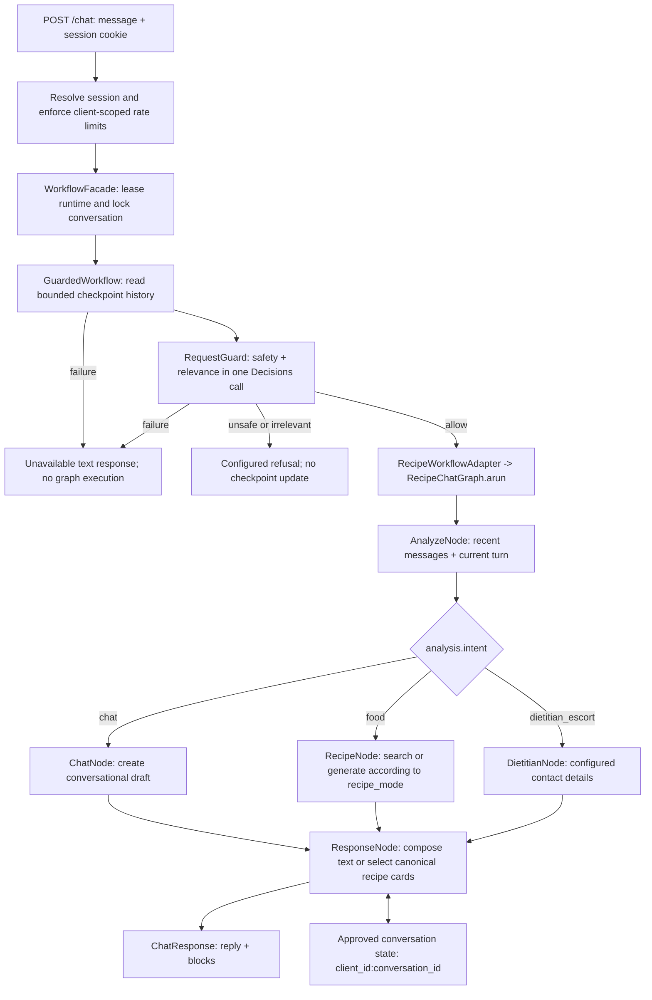
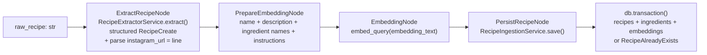

# Dietitian chat — exact runtime flow

Messages can include up to ten photos before the business graph: validate/normalize
all photos, guard them together with the text, recognize ingredients, then pass
text plus observations into the flow below. See
[iteration 11](iterations/11_MULTIPLE_PHOTOS.md) for the request format and limits,
and [iteration 10](iterations/10_PHOTO_CHAT.md) for configuration and release setup.

## Database client routing

`CLIENT_CONFIG_SOURCE=database` serves `/c/{slug}` and
`/api/clients/{slug}/chat`. PostgreSQL resolves the URL, pins each browser conversation
to a release, and serializes turns across workers. The facade loads the pinned
release's bindings, then applies the same admission-before-execution flow described
below. See [iteration 9](iterations/09_CLIENT_RELEASES_AND_BINDINGS.md) for the full
request diagram and migration procedure. File mode retains the original routes.

## Legacy file-mode request

In legacy file mode, the dietitian is selected once per deployment. See [deployment configuration](DIETITIAN_DEPLOYMENTS.md).

This is the path of one `POST /chat` request. Node names are LangGraph keys. Methods are the real callables.

The API calls `ChatWorkflow.respond(ConversationRequest)` through a facade-bound
proxy in `app.state.workflow`. The facade acquires a cached runtime and the local
conversation lock. `GuardedWorkflow` checks admission; on approval its
`RecipeWorkflowAdapter` translates the request to
`ChatGraphRequest`, runs the graph below, and returns `ChatResponse(reply, blocks)`.
The API keeps `app.state.workflow_facade` for diagnostics and warms the selected
workflow at startup. On shutdown the facade drains turns and closes runtime-owned
resources before the checkpoint pool closes. The deployment still selects one
dietitian at startup. See [iteration 7](iterations/07_FACADE_STARTUP.md).

Selecting `chat_graph=json_recipe` builds the same behavior from
`config/workflows/recipe_chat.json` through the new compiler. Its response step is
named `respond`. The compiler derives state fields from node contracts and checks
state access and updates; see [iteration 3](iterations/03_JSON_WORKFLOW_COMPILER.md).

---

## GraphState fields (per-conversation state)

Written incrementally and isolated by checkpoint thread. Users share the compiled
graph, not a mutable state object. `messages` uses `add_messages` to merge message
updates; new message IDs append, while an existing ID updates that message.

| Field | Type | Who writes it | Purpose |
|---|---|---|---|
| `user_id` | `str` | `RecipeChatGraph.arun` | Session from cookie `alona_session`; thread ID is `dietitian_id:user_id` |
| `message` | `str` | `arun` | Latest user text only |
| `analysis` | `MessageAnalysis \| None` | `AnalyzeNode` | Intent + recipe mode + ingredients |
| `validation` | `RequestValidation \| None` | Reset by Python `arun` | Legacy checkpoint channel, now always cleared; admission lives outside graph state |
| `result` | `dict \| None` | Chat / Recipe / Dietitian nodes | Structured work product for `ResponseNode` on an admitted turn |
| `dietitian_id` | `str` | Startup context / `arun` | Ownership and history namespace |
| `messages` | `list[BaseMessage]` | `arun` + Chat/Response | Rolling conversation (checkpointer persists it) |
| `final_response` | `str \| None` | `ResponseNode` | Complete Markdown for conversation history and older clients |
| `response_blocks` | `list[dict] \| None` | `ResponseNode` | Ordered text and recipe cards; each recipe includes its own saved image |
| `context` | `dict` | unused today | Reserved |

### MessageAnalysis fields

| Field | Values | Why it exists |
|---|---|---|
| `intent` | `chat` / `food` / `dietitian_escort` | Selects the business branch through `route_after_analysis` |
| `recipe_mode` | `existing` / `inspired` / `original` / `none` | Used **inside** `RecipeNode`, not for routing |
| `ingredients` | `list[str]` | Keywords for SQL substring match |
| `preferences` | `list[str]` | Passed into generation prompts |
| `confidence` | `float` | Stored, not used for branching |

---

## Chat graph (runtime)

The graph starts only after admission. There is no speculative branch or internal
validator. Guard failure is fail-closed; the API does not replay an entire turn
after a database error. Default settings are in `config/guard.json`; client files
and `GUARD_CONFIG` can select a different trusted policy. History reads and
evaluation each have a timeout. Admission results are logged without message text.
See [iteration 8](iterations/08_GUARD_STARTUP.md) for configuration and migration.

---

## Recipe presentation

For saved recipes, `ResponseNode` asks for a `RecipePresentationPlan` containing
intro text, explicit recipe IDs, and optional follow-up text. `build_recipe_response`
selects only those IDs from the search results and copies each recipe's saved name,
ingredients, instructions, source, and photo into one `recipe` block. Mentioning an
alternative in prose does not select its photo. Unknown IDs are rejected.

The frontend renders `blocks` directly in order, independently of the model's
Markdown headings. Text blocks cannot introduce extra photos. Missing photos leave
the rest of their recipe visible. `reply` contains the same selected recipes as
Markdown for history and older clients, with photos beside their respective titles;
the API never appends a gallery of search-result images.

`RecipeChatGraph.arun` clears per-turn analysis, validation, result, and presentation
fields before each invocation. Conversation messages remain available, while stale
recipe cards and rejection state cannot carry into the next response.

## Why routing is intent-only

`route_after_analysis` picks chat, recipe, or dietitian from `analysis.intent`.
The JSON equivalent selects the `recipe_intent` router. Admission has already
completed before analysis. Inside the recipe branch, `analysis.recipe_mode` selects a method:

- **existing** — user wants a saved Alona recipe (`מתכון של אלונה`, `שמור אצלך`)
- **inspired** — new recipe in her style
- **original** — invent, explicitly not from the DB (`יצירתי`, `לא מהמתכונים של אלונה`, `עוד רעיון`)
- **none** on a food intent is treated as **existing** so “יש לי אורז” still searches

Overrides run on the **latest user turn only**, because conversation history kept the word אלונה and forced lookup.

---

## Ingestion graph (offline)

`RecipeIngestionState`: `raw_recipe`, `instagram_url`, `recipe`, `embedding_text`, `embedding`, `recipe_id`, `success`, `error`.

---

## Persistence

- **Recipes:** `recipes` / `recipe_ingredients` / `recipe_embeddings` (vector 1536)
- **Chat memory:** LangGraph `AsyncPostgresSaver`, `thread_id = client_id:conversation_id`
- **Why cookie not body `user_id`:** client-supplied ids let anyone join another thread
