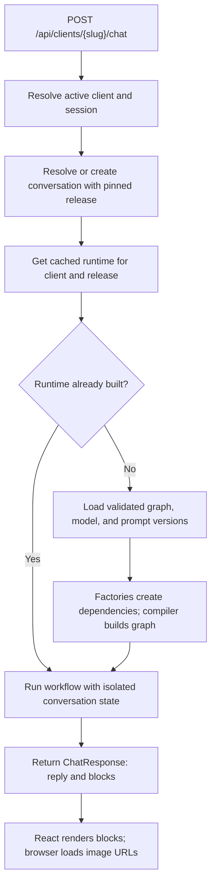

**Configurable chat workflows: implementation plan and tradeoffs**

Prepared on 2026-10-26. This is a proposed implementation plan, based on the current repository. The modules, database tables, and management commands proposed below have not been implemented by creating this document.

**Implementation status:** [Iteration 9](iterations/09_CLIENT_RELEASES_AND_BINDINGS.md)
now implements database URL routing, immutable releases and prompt versions,
conversation pinning, typed node bindings, and PostgreSQL turn locks. The original
plan below records the design sequence; the iteration document describes the
delivered schema, supported workflows, migration commands and remaining limits.

[Iteration 10](iterations/10_PHOTO_CHAT.md) adds optional photo messages, image-aware
admission, configurable ingredient recognition and frontend attachment controls.

I recommend creating the initial graph skeleton from a validated JSON definition. Python should implement the nodes, services, state schemas, routing functions, and the compiler that turns that definition into a LangGraph workflow. Start with a small configuration language that can reproduce the existing recipe workflow. Extend it when a second real workflow requires more capabilities.

This answers the JSON-versus-Python question directly: JSON selects and connects existing capabilities; Python defines what those capabilities do. Changing supported connections, service selections, prompts, or model profiles can become a configuration release. A new node, service, routing algorithm, or state schema requires a code change and deployment. Keep a registered Python workflow factory available for unusual workflows that cannot reasonably be expressed by the JSON format.

| Decision | Recommendation |
|---|---|
| Node instances and their names | Declare in JSON |
| Ordinary edges and conditional destinations | Declare in JSON |
| Logic that decides a conditional route | Implement in Python; select its registered name in JSON |
| Service implementations and model selections | Select registered implementations in configuration |
| Abstract contracts and allowed constructor dependencies | Define in Python |
| State fields, reducers, and node input/output requirements | Define trusted contracts in Python; derive each graph's schema from its inputs and selected node outputs |
| Prompt text | Store immutable versions as database rows |
| Prompt selection for a client | Bind logical prompt names to exact prompt version IDs in a client release |
| Client ownership and conversation identity | Resolve on the server and pass explicitly |
| Runtime service instances and compiled graphs | Construct in Python and reuse with a bounded cache |

LangGraph already provides the execution engine: a builder defines state, nodes, and edges, then compiles the graph. Our compiler would translate validated configuration into those operations; it would not implement another graph executor. See the [LangGraph graph API](https://docs.langchain.com/oss/python/langgraph/graph-api).

**Additional guard iteration:** [Iteration 4: request guard](iterations/04_REQUEST_GUARD.md)
adds an opt-in guard independent of graph topology, a Decisions API adapter, and a
workflow wrapper shared by API and CLI. The wrapper requires approval before graph
execution. [Iteration 8](iterations/08_GUARD_STARTUP.md) now enables it in default
API/CLI startup and replaces the internal guard with intent routing. The former
fail-open behavior and speculative branches are deliberately retired.

**Construction tracing delivered:** [Iteration 5: graph build trace](iterations/05_GRAPH_BUILD_TRACE.md)
adds file traces for JSON, Python recipe, and ingestion graph construction. It also
records the recommended next iteration: wire the new guard into shared startup,
replace internal validation with business routing, then finish typed JSON service
bindings before database-backed client releases.

**Runtime cache delivered:** [Iteration 6: workflow facade and cache](iterations/06_WORKFLOW_FACADE_CACHE.md)
adds a reusable facade, bounded cache keyed by client/release, shared construction,
resource cleanup, and conversation turn locks within one process. API/CLI contract
compatibility is tested. [Iteration 7: facade startup](iterations/07_FACADE_STARTUP.md)
connects default API/CLI startup, warms the cache, and closes owned database/provider
resources before checkpoint storage. Iteration 9 adds persisted release resolution
and coordination across workers in database mode.

The current code provides useful foundations:

- [ServiceFactory](../backend/factories/service_factory.py) validates registered implementations against a service contract.
- [Service contracts](../backend/services/contracts.py) distinguish analysis, validation, search, generation, presentation, and ingestion.
- [RecipeChatBuilder](../backend/graphs/builders/recipe_chat_builder.py) constructs a fixed container of recipe-related nodes. It does not define edges.
- [RecipeChatGraph](../backend/graphs/recipe_chat_graph.py) routes admitted requests through `analyze -> chat/recipe/dietitian -> response`.
- [GuardedWorkflow](../backend/workflows/guarded.py) now enforces admission before any graph execution. The former composite `GuardNode` remains only as legacy code/tests.
- [Bootstrap](../backend/bootstrap.py) currently constructs recipe dependencies before selecting the graph.
- [FastAPI](../backend/web/api.py) retains file mode and now supports database-backed client URLs and releases.

**The implementation order below is the order I would follow.** Each step has a concrete result and a check before moving on. The first usable milestone is step 5: the current recipe behavior running from JSON, with the existing deployment model. Database-driven clients come afterward.

1. **Record the current behavior as the migration baseline.**

   Review and run the existing graph, guard, presentation, factory, and tenancy tests before changing runtime code. Record any pre-existing failures. Use deterministic model doubles for graph comparisons so an LLM wording change does not look like an architecture regression.

   Preserve recipe modes, tenant filtering, session namespace, response blocks, saved recipe images, and clearing of per-turn state. The original baseline recorded speculative validation and continuation on validator errors. Iteration 8 deliberately changes these semantics: admission now precedes graph execution, failures stop the turn, and rejected turns write no checkpoints.

   Relevant tests include `tests/test_chat_graph_builder.py`, `tests/test_chat_graph_selection.py`, `tests/test_guard_node.py`, `tests/test_graph_presentation.py`, `tests/test_chat_presentation_api.py`, and `tests/test_tenancy.py`.

   **Done when:** the existing behavior is documented by passing checks or explicitly recorded baseline failures, and there is a deterministic set of conversation scenarios to compare against the new builder.

   **Completed iteration:** [Iteration 1: workflow baseline](iterations/01_WORKFLOW_BASELINE.md), 2026-10-26. The existing offline suite passed 166 tests; nine new deterministic graph scenarios brought the passing total to 175. Runtime code is unchanged. Real PostgreSQL integration tests were excluded; the report records that verification boundary.

2. **Introduce a generic workflow boundary without removing recipe-specific state.**

   Add proposed modules `backend/workflows/contracts.py` and `backend/clients/context.py`. Define an immutable `ClientContext` and a `ConversationRequest` carrying server-resolved client identity, session/conversation identity, message, and release identity. Expose an asynchronous workflow method returning the existing `ChatResponse`, rather than returning the recipe graph's internal `GraphState` to the API.

   Add an adapter around `RecipeChatGraph` that preserves its current initialization and per-turn reset behavior. Keep `GraphState` as the recipe workflow's internal state schema. Another workflow can register another state schema while returning the same public response contract.

   Reuse the existing abstract service contracts. Add a new contract only when the required operations or data semantics differ. Do not create separate chef and dietitian abstract classes solely because their branding or prompts differ.

   **Done when:** the existing API and CLI can execute the recipe workflow through the adapter, and a small test workflow with different internal state can return a valid `ChatResponse` without constructing recipe nodes.

   **Completed iteration:** [Iteration 2: workflow boundary](iterations/02_WORKFLOW_BOUNDARY.md), 2026-10-26. API and CLI now call `ChatWorkflow.respond(ConversationRequest)` through a recipe adapter. A separate counter-state workflow proves the boundary works without recipe nodes. The offline suite passes 189 tests; database integration tests remain excluded. JSON schemas and runtime selection are later steps.

3. **Define the first JSON schema and its limits.**

   **Compiler iteration delivered:** [Iteration 3: JSON workflow compiler](iterations/03_JSON_WORKFLOW_COMPILER.md) implements a versioned topology format, typed node/router registries, state-field derivation, dependency checks, runtime validation, and a JSON recipe graph selectable as `json_recipe`. This covers the topology/state portions of steps 3–5. Following the design discussion, state schemas are composed from Python field contracts rather than selected as one fixed schema by JSON. JSON service/child/model binding declarations described below remain planned; this first version uses the existing Python service assembly.

   Add `backend/config/workflows.py` with validated models for `WorkflowSpec`, `NodeSpec`, `ServiceSpec`, `EdgeSpec`, and `RouteSpec`. Include a configuration schema version. Use strict fields and reject unknown properties. Use tagged configuration variants where different node or service kinds accept different settings; [Pydantic discriminated unions](https://docs.pydantic.dev/latest/concepts/unions/#discriminated-unions) support this selection.

   Support ordinary edges, named conditional routers, explicit entry/exit, registered state schemas, service references, and registered composite nodes. Keep fan-out/join scheduling, general expressions, and arbitrary nested graph definitions outside the first format. The existing guard can retain its concurrency inside Python. A later schema version can add a capability when a real workflow needs it.

   Use one workflow manifest with logical sections for nodes, services, edges, and routes. Models and prompt bindings can be supplied by the immutable client release described below. Do not create several independently editable files repeating the same abstract-to-concrete mappings.

   Configuration selects registered keys, not Python import paths, executable expressions, or serialized runtime objects. Names declared in the database cannot create a new implementation by themselves.

   **Done when:** valid examples parse, invalid configuration produces errors identifying the exact field/node, and the exported JSON schema describes every supported option.

4. **Add typed registries and validate dependency compatibility.**

   Add `backend/workflows/registry.py` and `backend/workflows/validation.py`. Reuse `ServiceFactory` where possible. A node registration declares its builder, accepted dependency slots, required service contracts, compatible state schema, and declared input/output fields. Service registrations declare their implementation, configuration model, prompt slots, and resource requirements. Router registrations declare their possible outcomes.

   For example, an analysis node's `analyzer` slot requires `BaseMessageAnalyzer`; a generation service cannot fill that slot. The JSON does not get to override this requirement. Factories instantiate concrete classes satisfying the contracts.

   Validate names, dependency references, required settings, node IDs, edge endpoints, routing outcomes, reachability, and supported state compatibility before building the workflow. Check declared data requirements along the supported paths. Reject unsupported compositions rather than pretending arbitrary Python behavior can be proven correct from annotations.

   Keep runtime result validation and execution tests: inheritance checks do not prove method return values, correct business behavior, or LLM accuracy. If loops are added later, require explicit execution limits and compatible state handling; do not reject all cycles merely because they are cycles.

   **Done when:** a recipe search service supplied to an analyzer slot fails before a model call or workflow execution, and a node scheduled before its required data exists is rejected where the declared contracts make that error detectable.

5. **Compile the existing recipe topology from a local JSON manifest.**

   Add `backend/workflows/compiler.py`, `backend/workflows/adapters/recipe.py`, and `config/workflows/recipe_chat.v1.json`. The compiler validates the manifest, resolves dependencies, constructs services and nodes, adds edges and named routers, then compiles with the injected checkpointer.

   Updated in iteration 8: admission is a workflow wrapper. Chat, recipe, and contact are ordinary graph nodes selected by an intent router. Configuration can change business topology without bypassing managed admission. The earlier composite-guard proposal is superseded.

   Refactor `bootstrap.create_app()` to select a workflow builder before constructing domain dependencies. The recipe builder can reuse existing services. Other builders must not be forced to create recipe repositories, embedding clients, or all six recipe nodes. Stop requiring `RecipeChatNodes` as the universal workflow container.

   Keep the existing Python recipe graph available during parity checks. Compare both paths using the same model doubles for chat, saved recipes, inspired recipes, original recipes, no results, contact requests, refusals, validator errors, and follow-up turns. Compare selected recipe IDs, image associations, state transitions, and checkpoint behavior.

   **Done when:** the JSON-built recipe workflow preserves existing behavior, and changing a supported edge or implementation in the manifest changes the constructed workflow without editing the compiler.

The runnable topology is now [config/workflows/recipe_chat.json](../config/workflows/recipe_chat.json).
It contains analysis, three business branches, a response node, and the
`recipe_intent` router. Typed service/prompt/model binding declarations remain
the next assembly extension. Earlier composite-guard JSON proposals are superseded.

6. **Add database records for clients, workflow versions, prompts, and releases.**

   Add an explicit migration plus repositories under `backend/persistence/repositories/`. Introduce the tables described below. Keep the existing text client identifiers such as `clinic_001` during the migration; introducing a second UUID for the same client is unnecessary. Add a unique URL slug separate from the display name. Version and release records can use UUID primary keys.

   A workflow version describes reusable topology. A client release selects that workflow version and freezes the client's service options, model profiles, prompt bindings, and relevant profile settings. This extra release record prevents a prompt or model edit from silently changing a published workflow and lets clients reuse the same topology.

   **Done when:** a repository can resolve an active client by slug and load one complete immutable release, and all referenced workflow/prompt versions exist and belong to that client or an explicitly shared catalog.

| Proposed table | Essential fields and constraints |
|---|---|
| `clients` | Existing-compatible text `id`, unique `slug`, display name, business type, active flag, active release reference |
| `workflow_versions` | `id`, workflow key, version, configuration schema version, `definition_json`, publication status; unique key/version |
| `prompt_versions` | `id`, optional owner client ID for shared templates, logical key, version, template text, variable schema; unique owner/key/version, with explicit uniqueness for shared rows |
| `client_releases` | `id`, client ID, release number, workflow version ID, resolved configuration JSON, publication status; unique client/release number |
| `conversations` | `id`, client ID, session ID, pinned release ID, checkpoint thread ID; preserve the current one-conversation-per-client/session behavior initially |

Enforce release ownership when assigning `clients.active_release_id` or a conversation's release. Use composite ownership constraints where applicable. Published configuration and prompt content are immutable; edits create new versions. Store API credentials through the existing environment/secret mechanism, with configuration referring to credential names if needed.

7. **Implement prompt resolution and import existing templates.**

   Add `backend/services/prompts/prompt_repository.py` and `backend/services/prompts/prompt_renderer.py`. Import `config/prompts/` and per-client overrides from `config/dietitians/<id>/prompts/` as versioned records. Preserve the current template syntax and validate required variables using the contracts in `backend/tenancy.py` as the migration baseline.

   A service definition declares logical prompt slots such as `system`, `original`, or `inspired`; the client release binds them to exact prompt version IDs. Prefer explicit bindings in a published release. Resolve shared defaults while preparing the release, rather than looking up an unversioned "latest" prompt during a request.

   Inject templates into the service that uses them. Render current message/history/ingredient variables during execution. Inject presentation/refusal templates into nodes that currently render them directly. Database-only services have no prompt slots; missing required LLM prompts fail validation instead of producing silent empty behavior.

   **Done when:** imported templates render equivalently to the file-based versions, missing or unexpected variables are detected, and changing a draft prompt cannot alter an active release.

For example, the recipe generator can declare both `original` and `inspired` slots. Their templates are two prompt records, not two columns added to a table for each runtime service. If bindings later need independent relational queries, introduce a release/prompt binding table; do not store a second conflicting source of truth alongside JSON bindings.

8. **Generalize data ownership and dependency lifetimes.**

   Import existing dietitian profiles into clients and their initial releases. Separate common branding/contact settings from recipe-specific options. Chefs must not be required to supply fields whose only meaning is a dietitian-specific behavior.

   Replace deployment-global tenant selection in repositories with immutable client-bound repository instances or explicit transaction context. Refactor `Database` so lightweight client scopes can share a managed connection pool without mutating a shared `dietitian_id`. Set the database ownership context transaction-locally on every client operation. Keep explicitly shared catalog queries separate from client-owned data queries.

   Migrate the existing `dietitian_id` ownership columns, foreign keys, composite keys, SQL filters, and row-level policies together to generic client ownership. The current policies read `app.dietitian_id`; changing only Python names would break filtering. Preserve identifier values and use a documented maintenance cutover for the coordinated schema/code change. Before that cutover, build and verify the new tables and imports additively. Record how to restore the database backup and old application version if the cutover fails; do not run incompatible old workers against the renamed schema.

   Keep legacy checkpoint thread keys through a compatibility mapping rather than rewriting LangGraph checkpoint internals. For migrated sessions, bind the existing `dietitian_id:session_id` thread to an equivalent initial release. New conversations can use a client/conversation namespace.

   **Done when:** disposable PostgreSQL tests prove two clients cannot read or modify each other's recipes, ingredients, embeddings, or prompt ownership, and existing recipe/image references and conversation keys remain resolvable.

9. **Implement release validation, publication, and activation.**

   Add `backend/workflows/releases.py` and management CLI commands using the existing CLI command pattern. Proposed operations are import, validate, publish, activate, and rollback. These names describe work to implement; they are not current commands.

   Validation resolves the complete workflow, model definitions, prompt bindings, and dependencies, then performs structural checks, compiles with test dependencies, and runs deterministic example conversations. Publication freezes the resolved release. Activation atomically changes a client's active release only after the new version passes validation and can be constructed with its required resources.

   A new conversation uses the active release; an existing conversation keeps its pinned release. Rollback changes the default for new conversations. Moving an existing conversation to an incompatible workflow requires an explicit state migration or a new conversation. Reject activation of a release whose required implementation version is unavailable on the serving workers.

   **Done when:** invalid activation leaves the previous release active, draft edits are invisible to users, rollback selects the prior release, and conversations remain pinned across process restarts.

10. **Build the shared chat service and runtime cache.**

    **Partial delivery:** iteration 6 implements the cache and invocation facade;
    iteration 7 connects default chat startup and owned resource cleanup.
    Client lookup, persistent conversation release pinning, and distributed turn
    coordination described in this step remain planned.

    Add `backend/services/chat/chat_service.py` and `backend/workflows/runtime.py`. The service resolves the client, session, pinned release, and runtime, then invokes the workflow and returns `ChatResponse`. The cache key includes client ID and immutable release ID. This is a cache of compiled workflow instances, not a shared conversation state dictionary.

    Use per-key asynchronous construction locks so simultaneous first requests do not construct duplicate runtimes. Bound the cache, close owned resources on eviction/shutdown, and avoid evicting an instance while requests are using it. Share application-owned pools and eligible model clients by their complete configuration and credential identity. Keep request-specific data in graph state or invocation context.

    Coordinate turns for the same conversation so two tabs or workers cannot overwrite checkpoint progress. Use a database-backed per-conversation lock or equivalent serialization across processes, with an explicit busy/timeout policy. Initial conversation creation and release pinning must also be atomic.

    **Done when:** concurrent clients remain isolated, simultaneous first use builds once per cache key within a worker, old and new releases coexist, and two messages for the same conversation cannot race through checkpoint updates.

11. **Route FastAPI and React by client, including images and public configuration.**

    Modify `backend/web/api.py` so startup owns registries, pools, repositories, and the chat service. Request handling resolves the client from the URL; it does not overwrite a shared `app.state.tenant` or `app.state.graph`.

    Introduce `POST /api/clients/{slug}/chat`, `GET /api/clients/{slug}/public-config`, and `GET /api/clients/{slug}/recipe-images/{filename}`. Unknown or inactive clients return 404. A client without a usable active release returns a clear unavailable response. Keep body validation, the server-issued session cookie, and client-scoped rate limits. Keep the current legacy routes as optional aliases only when an explicit default client is configured; do not fall back to a random client.

    Modify `Frontend/src/api.js`, `Frontend/src/components/deploymentConfig.js`, `Frontend/src/App.jsx`, and `Frontend/vite.config.js`. Choose a site URL such as `/c/{slug}`; parse and validate that route, request its public configuration, and use the same slug for chat. Reset displayed messages when switching clients and discard late responses belonging to the previous client. Configure the production server to serve the SPA entry for `/c/{slug}` while leaving `/api/` and assets intact.

    Generate image URLs containing the resolved client slug or an unambiguous storage key. The current global `/recipe-images/{filename}` route depends on the deployment tenant and cannot identify a client in a shared deployment. Preserve its direct-file checks. Continue sending image URLs in recipe blocks; React's existing image rendering can remain. Keep PostgreSQL references and durable image storage separate, and plan storage shared by all workers before using multiple replicas.

    **Done when:** two client URLs can be open in the same browser and show the correct branding, recipes, images, and independent histories. A filename reused by two clients resolves to each client's own photo.

12. **Add a genuinely different workflow and verify the complete lifecycle.**

    Add a chef workflow whose topology differs from the recipe assistant: for example, a registered `menu_plan` node that creates a structured menu followed by a `menu_response` node that returns existing text blocks. Give it its own state schema and a typed menu-planning service. Register those Python capabilities once, then select/connect them through another JSON definition. It should not construct dietitian contact nodes or recipe-search resources unless its declared behavior needs them.

    Keep the initial frontend response limited to existing text and recipe blocks. Add a new response block and React component only if the second workflow actually needs a new UI representation. A new backend block type is a coordinated API/frontend change.

    Add focused checks for malformed definitions, missing dependencies/prompts, unknown router outcomes, client isolation, release pinning/rollback, concurrent runtime construction, checkpoint serialization, recipe presentation, client URL switching, and image ownership. Run integration tests against disposable PostgreSQL using the existing fixture pattern, never by resetting production data.

    Update `docs/CHAT_FLOW.md`, `docs/SERVICE_CONFIGURATION.md`, and `docs/DIETITIAN_DEPLOYMENTS.md` to describe the final system. Update CLI ingestion to take an explicit generic client selection, use the migrated repositories, and import client assets without relying on a dietitian-only global context.

    **Done when:** a dietitian workflow and a chef workflow run concurrently in one process with different topology, both use the shared HTTP contract, and a supported configuration change can be activated without changing Python code.

The implementation checks would include `python -m pytest -q` from the project root, plus `npm test`, `npm run lint`, and `npm run build` from `Frontend`. These are future implementation checks; creating this planning document does not establish that they pass. Database fixture availability and existing failures should be reported explicitly rather than silently skipped or attributed to the design.

**A request in the completed design would follow this sequence:**

**Advantages of this design**

| Advantage | What it gives this project |
|---|---|
| Different workflows in one application | Chefs and dietitians can select different topology while sharing API, sessions, logging, and infrastructure |
| Controlled configuration changes | Existing capabilities can be rearranged and configured without a Python deployment |
| Reusable implementation contracts | One analyzer or search service can be reused wherever its contract and state requirements match |
| Explicit prompt ownership and history | Each release identifies the exact prompt versions used, supports rollback, and avoids service-specific nullable columns |
| Earlier configuration failures | Missing services, invalid routes, and many state/dependency mismatches can fail before a client release is activated |
| Reproducible debugging | Logs can identify client, release, workflow, node, model profile, and prompt versions for a problematic turn |
| Consistent frontend | Existing text/recipe blocks and browser image loading work across compatible workflows |
| Deployment flexibility | The same code and release model can later run in shared or dedicated deployments |

**Disadvantages and how I would manage them**

| Cost or limitation | Practical response |
|---|---|
| More initial work than a Python graph | Deliver the existing recipe graph from a local manifest first; defer the management UI and general-purpose graph features |
| Configuration becomes another language to maintain | Version its schema, keep it small, and provide errors with exact node/field paths |
| Fewer editor guarantees for JSON wiring | Use generated schemas, registry metadata, static Python checks, explicit build validation, and execution tests |
| Arbitrary node combinations are not automatically valid | Register supported state schemas and declared dependencies; reject unsupported compositions |
| New capabilities still need code | Be explicit that JSON configures deployed implementations; retain a custom Python workflow factory for exceptional cases |
| Debugging spans code and configuration | Trace a turn with its immutable release and component identities, without relying on mutable defaults |
| Published graph changes can invalidate conversation state | Pin conversations to releases and implement explicit migrations or start new conversations |
| Shared hosting makes isolation and contention application concerns | Scope repositories, prompts, caches, rate limits, files, and conversation locks by client; add shared rate-limit storage before multiple workers |
| Cached runtimes consume resources | Bound caches, reuse managed pools, close owned resources, and retain old releases only while needed |
| More deployment compatibility rules | Track required registry/configuration versions and keep old implementations available while conversations still depend on them |
| Schema migration is more than renaming a field | Migrate foreign keys, row policies, ownership context, files, and history mapping together under a tested cutover |
| Model output remains probabilistic | Validate structured outputs and evaluate representative conversations; correct graph assembly does not guarantee a correct answer |

Admission now completes before business execution, and whole-turn database retries have been removed. Future state-changing nodes still require explicit authorization, idempotency, and resume rules. Release pinning must address incompatible or in-progress checkpoints when topology changes.

For one fixed workflow with only branding and prompt differences, a Python-defined graph remains simpler. The reason to implement this plan is the stated requirement to vary node connections and strategies across clients. The first implementation should therefore prove both the existing recipe workflow and one different workflow before expanding the configuration language further.
