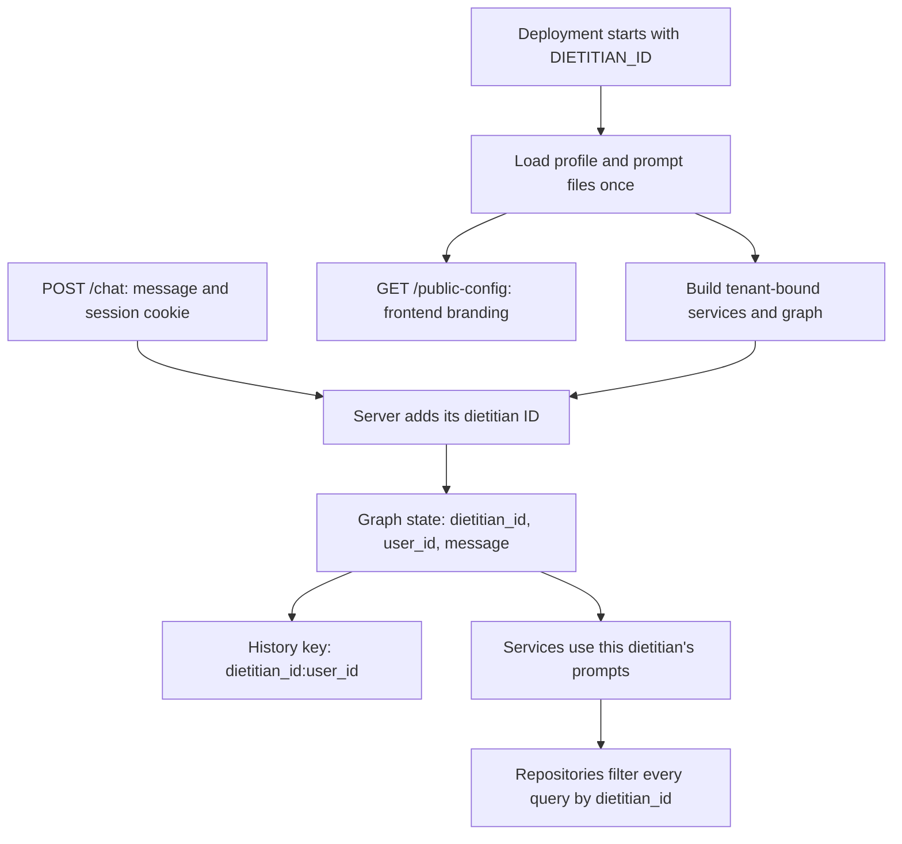

# One codebase, one dietitian per deployment

Run the same server and frontend for every clinic. Each deployment selects one
immutable `DIETITIAN_ID` at startup. Both deployments can use the same PostgreSQL
database and the same table names.

| Deployment | Example address | `DIETITIAN_ID` | Profile |
| --- | --- | --- | --- |
| Alona | `alona-clinic.example.com` | `clinic_001` | `config/dietitians/clinic_001/profile.json` |
| Dana demo | `dana-clinic.example.com` | `clinic_002` | `config/dietitians/clinic_002/profile.json` |

These addresses are examples; this change does not provision domains or Railway
services. Dana is a demo configuration with no recipes or contact form.
Two dietitians can have the same display name. Give them different permanent IDs
and different addresses. Changing a display name does not change ownership of rows.

## Follow one request



The browser still sends `{"message": "I want tofu"}`. It does not select a
dietitian. A `dietitian_id` field in the JSON body is rejected. Query parameters
cannot switch the deployment. The public configuration contains branding only,
not prompts, credentials, or model settings.

`TenantContext` is the immutable startup snapshot injected into services, the
node builder, and graphs. This is configuration plus dependency injection.
`create_http_app()` creates a FastAPI application using the same route code for
every deployment; there are no copied `/alona/chat` and `/dana/chat` handlers.
The existing service factories, model registry, and fluent node builder remain.
The embedding provider remains OpenAI.

## Configure a dietitian

1. Choose a new permanent ID, for example `clinic_003`. IDs use lowercase letters,
   digits and underscores, start with a letter, and contain at most 64 characters.
2. Copy `config/dietitians/clinic_002/` to `config/dietitians/clinic_003/`.
3. Set `dietitian_id` inside `profile.json` to `clinic_003`. Set the names, aliases,
   contact URL, frontend title, welcome text, starter messages, and accent color.
4. Put this clinic's images in `data/dietitians/clinic_003/recipe_images/`.
   Optional `branding.inspiration` entries refer to filenames in this directory.
5. Set `DIETITIAN_ID=clinic_003` for that deployment and start the same application.

No Python or JavaScript changes are needed to add a profile. In a fresh database,
recipes are empty until you run ingestion. The UI uses one shared JavaScript
bundle and fetches its branding from `/public-config`; it does not bundle Alona's
photos into every clinic's frontend. `/recipe-images/<filename>` serves only the
current deployment's image directory. Recipe images are public site assets.

All LLM system/instruction templates live in `config/prompts/*.txt`. The matching
file in `config/dietitians/<id>/prompts/` overrides a shared template. For example,
add `generate_original.txt` there to change one dietitian's recipe-writing style.
The bundled profiles demonstrate an override with `prompts/chat.txt`.

Templates use `${display_name}`, `${name_he}`, and `${assistant_name}`.
Generation templates additionally accept `${ingredients}`, `${preferences}`,
and, for inspired recipes, `${reference_recipes}`. Contact text accepts
`${contact_url}`. Unknown placeholders, empty prompts, unknown override filenames,
invalid profiles, and unknown IDs fail startup. Use `$$` for a literal dollar sign.
Profile aliases also drive the analyzer's Python routing rules.

Files are read once during startup. Restart after editing a profile or prompt.
When these files are stored in Git, commit/push and deploy the new revision.
Changing the deployment's environment selection requires restarting/redeploying
that service, not editing its Python code. Set `DIETITIAN_ID` explicitly on
Railway; local development defaults to `clinic_001` for compatibility.

## Database ownership and migration

The shared tables are `dietitians`, `recipes`, `recipe_ingredients`, and
`recipe_embeddings`. Each recipe, ingredient, and embedding has a non-null
`dietitian_id`. Every repository read and write includes its bound ID, including
ingredient matching, duplicate detection, and vector search when there are no
ingredient matches. Recipe names and Instagram URLs are unique **within** a
dietitian. Composite foreign keys prevent an ingredient or embedding for one
dietitian from referring to another dietitian's recipe.

A new empty database can initialize automatically. An existing database with
unowned recipes deliberately stops startup. Before upgrading an existing Alona
database:

1. Back it up and stop the old application instances. Old code does not filter
   by tenant and must not run against the shared tenant schema.
2. Configure the database connection for an administrative/schema-owner account.
3. Run this once, explicitly identifying the owner of the old recipes:

   ```powershell
   python -m backend.persistence.migrate --legacy-dietitian-id clinic_001
   ```

4. Start the new deployment(s), each with its own `DIETITIAN_ID`.

The migration backfills the three recipe tables together, preserves recipe IDs
and URLs, replaces global uniqueness with tenant uniqueness, adds constraints
and row policies, and records the schema version. It runs in one transaction
under a database lock. A failure rolls everything back. Re-running it will not
transfer previously assigned recipes to another dietitian. No migration or data
change is automatically performed against Railway by this coding change.

Recipe tables also have PostgreSQL row-level security. `Database.transaction()`
sets `app.dietitian_id` locally for each transaction and the pool does not retain
that setting between borrowers. Use a non-superuser role without `BYPASSRLS` to
receive this additional protection. Repository filters still apply when using
an administrator connection. PostgreSQL superusers and `BYPASSRLS` roles bypass
these policies, including forced policies. See the
[PostgreSQL row-security documentation](https://www.postgresql.org/docs/16/ddl-rowsecurity.html).

The ID identifies a clinic; it is not an authentication mechanism. The current
chat interface is public and ingestion is an operator CLI command. Application
code/credentials remain trusted: a database administrator can access every row.

LangGraph owns its checkpoint tables. Their tenant boundary is the namespaced
`thread_id` (`clinic_001:<user-id>`), not an added column or recipe-table RLS
policy. All alternative chat graphs must use `request.thread_id`, include
`dietitian_id` in state, and reject IDs that differ from their startup context.
Old, unprefixed conversation history is left in place and is not reused; users
start a fresh conversation after this upgrade. The migration does not delete it.

## Run chat or add recipes

Local PowerShell, with database and provider credentials configured:

```powershell
$env:DIETITIAN_ID = "clinic_001"
python run_api.py
```

In a separate terminal, select the same clinic and add a recipe:

```powershell
$env:DIETITIAN_ID = "clinic_001"
python main.py ingest --file "data/recipes/your-recipe.txt"
```

For another deployment, use `clinic_002` (or your new ID) in that deployment's
environment. On Railway, run the ingestion command inside the selected service's
container/remote shell, where its environment and database connection are
available. No public ingestion endpoint is exposed. The recipe will be saved
under that service's ID, and chat will find it without rebuilding the graph.
The supplied text files in `data/recipes/` are Alona examples; select the intended
owner before ingesting them. Images must also be present in that owner's image
directory to be attached automatically by Instagram post code.

To call a graph from Python:

```python
tenant = load_tenant()
chat = create_app(tenant=tenant)
result = await chat.arun(ChatGraphRequest(
    message="Hi!", user_id="user-a", dietitian_id=tenant.dietitian_id,
))
```

Custom factory builders for prompt-aware services now receive `tenant` alongside
their other dependencies. Custom chat graph constructors also receive `tenant`.
They should retain and use the supplied context rather than loading or mutating
a global active dietitian during requests.

## Verify

```powershell
python -m pytest -q
$env:RUN_POSTGRES_TESTS = "1"
python -m pytest tests/integration -q
Remove-Item Env:RUN_POSTGRES_TESTS
cd Frontend
npm ci
npm test
npm run build
npm run lint
```

The normal tests use fake models and check two deployments, identity spoofing,
branding/media separation, prompt overrides, aliases, and checkpoint isolation.
The opt-in database tests require local PostgreSQL with pgvector and create a
disposable loopback server with temporary databases. They never use
`DATABASE_URL` or your configured application database. They check migration
rollback/idempotence, tenant filters, vector fallback, uniqueness, composite
foreign keys, atomic ingestion, RLS and pooled-connection reset.
