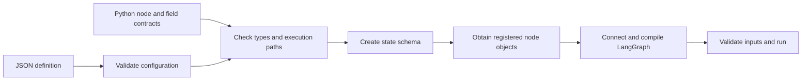

# Iteration 3: JSON workflow compiler

Date: 2026-10-26.

## Current input

> Create the compiler

The preceding design clarification was that a JSON node declares a `needs` list,
Python declares the types of those inputs and the node's outputs, and the compiler
derives the graph's state fields from initial inputs and registered outputs.

## Situation before this iteration

Iterations 1 and 2 established a recipe behavior baseline and the public
`ChatWorkflow.respond(ConversationRequest) -> ChatResponse` boundary. The offline
suite passed 189 tests. The recipe graph still connected nodes in Python.
`backend/workflows/compiler.py` contained design questions, without an implementation.

The questions in that file concerned accepting JSON, configuring nodes and state,
creating fields dynamically, recovering lost definitions, malicious graphs,
structured LLM output, and nodes returning partial state-update dictionaries.

The existing bootstrap already constructs services and recipe nodes. The API selects
one client and workflow at startup. Multi-client database routing and published
release management have not been implemented.

## Problem

A list such as `"needs": ["analysis"]` names a dependency but cannot tell us its type,
who produces it, or whether it exists when this node executes. A field can exist
in the state schema while its current-turn value is unavailable.

Checking only JSON syntax would also allow incorrect edges, incompatible producers,
missing conditional outcomes, and updates to fields a node does not own.

## Implemented solution

The compiler accepts JSON text, a dictionary, or a validated `WorkflowSpec`.
File loading is separate: the server chooses the path and calls `load_workflow_spec`.



The implementation uses LangGraph as its executor. It adds our configuration and
contract checks around [LangGraph's graph construction](https://docs.langchain.com/oss/python/langgraph/graph-api).
Runtime values are checked using [Pydantic TypeAdapter](https://docs.pydantic.dev/latest/concepts/type_adapter/).

### 1. Parse a small versioned configuration language

[backend/config/workflows.py](../../backend/config/workflows.py) defines strict
`WorkflowSpec`, `NodeSpec`, `EdgeSpec`, and `RouteSpec` models. Unknown properties,
invalid names, unsupported schema versions, and oversized node/edge collections
are rejected.

A complete working example is
[config/workflows/word_count.example.json](../../config/workflows/word_count.example.json):

```json
{
  "schema_version": 1,
  "name": "word_count_example",
  "nodes": [
    {"id": "analyze", "kind": "word_analysis", "needs": ["message"]},
    {"id": "respond", "kind": "word_reply", "needs": ["analysis"]}
  ],
  "edges": [
    {"from": "START", "to": "analyze"},
    {"from": "analyze", "to": "respond"},
    {"from": "respond", "to": "END"}
  ]
}
```

`id` identifies an instance in this graph. `kind` selects a registered implementation.
Node IDs must differ from state field names, as required by the underlying graph builder.

The configuration schema can be exported with `WorkflowSpec.model_json_schema()`.
It describes the configuration format; it is distinct from the runtime state schema.

### 2. Register trusted Python contracts

[backend/workflows/registry.py](../../backend/workflows/registry.py) provides:

- `StateField(annotation, reducer=None)`: a Python value type and optional merge function.
- `NodeDefinition(factory, inputs, outputs, optional_outputs)`: required reads, allowed
  writes, guaranteed writes, and a factory for the callable.
- `RouterDefinition(route, inputs, outcomes)`: a Python routing function and its allowed results.
- `WorkflowRegistry`: name-based lookup, with duplicate registration rejected.

Example from [the runnable demonstration](../../backend/workflows/example.py):

```python
registry.register_node("word_analysis", NodeDefinition(
    factory=lambda: analyze,
    inputs={"message": StateField(str)},
    outputs={"analysis": StateField(TextAnalysis)},
))
```

The factory captures server-created services. A node's `needs` list must exactly
match its Python input contract. Editing JSON cannot remove a required input or
change its type. Output types and reducers are also defined in Python.

The demonstration service counts words; it does not pretend to call an LLM.
A real analyzer can supply a Pydantic structured result through the same pattern.

### 3. Validate graph structure and field availability

[backend/workflows/validation.py](../../backend/workflows/validation.py) checks the
whole definition before the generic compiler invokes any node factory:

1. Node IDs are unique, node/router kinds are registered, and `needs` agrees with the contracts.
2. Edge endpoints exist and START/END are used correctly.
3. Each node has exactly one ordinary transition or one conditional router.
4. Every node is reachable, the graph has an exit, and the graph is acyclic.
5. Producers agree on each field's type and reducer; consumers require that same contract.
6. Protected initial fields cannot be written by nodes.
7. Each required input is available on every incoming execution path.
8. Routers have all their required inputs and exactly the declared outcome mappings.
9. Required final fields are guaranteed on every path to END.

At a merge of conditional alternatives, availability is the intersection of the
incoming paths. If only one branch writes `analysis`, a later node cannot require it.

An optional output may be omitted by its producer. That declaration alone does not
make it available to a downstream consumer. This version deliberately requires
exact field contracts rather than attempting general Python subtype inference.

### 4. Create the runtime state schema and graph

[backend/workflows/compiler.py](../../backend/workflows/compiler.py) exposes
`compile_workflow(...)`. It derives fields from the supplied initial-input contract
plus registered node outputs, then dynamically constructs a `TypedDict` for LangGraph.

The example derives:

| Field | Contract | Source |
|---|---|---|
| `message` | `str` | Invocation input |
| `analysis` | `TextAnalysis` | `analyze` node |
| `reply` | `str` | `respond` node |

No Python source is generated or evaluated. JSON does not contain import paths,
expressions, credentials, class definitions, or serialized runtime objects.

The compiler obtains registered node objects, adds ordinary/conditional edges,
and calls LangGraph's compile method. The result is a reusable
`CompiledWorkflowGraph` with `ainvoke`, `aget_state`, `fields`, and `state_schema`.
Its underlying `graph` is available for inspection; callers should invoke the wrapper
to retain initial-state validation and per-turn clearing.

### 5. Validate runtime reads and updates

For each invocation:

1. Require exactly the declared initial fields and validate their values.
2. Clear all derived fields to `None`, preventing stale checkpoint values from filling
   missing current-turn results.
3. Give each node a read-only mapping containing only its declared inputs, with a private
   copy of nested values.
4. Validate its returned dictionary: no undeclared fields, all guaranteed outputs
   present, and all values correctly typed.
5. Let LangGraph apply the validated update using the declared reducers.

Derived channels include `None` in their storage schema until populated. This does
not allow a node requiring `TextAnalysis` to read `None`: its stricter input contract
still applies. A node requiring an explicitly nullable field may receive `None`.

Pydantic model objects remain model objects. Existing model instances are revalidated
as well, so mutation or `model_construct()` cannot bypass ordinary value checks.
Synchronous nodes execute in a worker thread; asynchronous nodes are awaited.
Cancelling an invocation cancels its running async node. As with ordinary Python
threads, cancellation cannot forcibly stop a synchronous function already running.

Reducers are currently allowed only on explicitly initialized fields. For example,
`messages` receives the current human message on each invocation, and its reducer
merges that update into checkpointed history. Other inputs replace their previous values.

### 6. Bind and exercise the existing recipe workflow

[backend/graphs/compiled_recipe_chat_graph.py](../../backend/graphs/compiled_recipe_chat_graph.py)
registers the existing analysis, guard, and response nodes. It reads
[config/workflows/recipe_chat.json](../../config/workflows/recipe_chat.json).

The graph is `START -> analyze -> guard`, then either `respond -> END` or `END`
on rejection. The guard retains its existing concurrent validation/child execution.
Child branches are not separately scheduled.

The binding makes legacy omitted validation/presentation fields explicit as `None`.
It preserves the existing `client:conversation` checkpoint identity, tenant check,
presentation output, and validator-exception behavior. Client and conversation
fields are protected from node writes.

Recipe-specific policy also requires a guard and enforces its rejection route to
END. Type compatibility alone cannot prove such a business rule.

`ServiceFactories` now registers this graph as `json_recipe`. Existing service
factories still construct its services; JSON service slots, prompt versions, and
dependency selection are future work. The legacy bootstrap constructs services
before graph construction, so startup-wide preflight before external-resource
creation is also a separate follow-up.

## Try it

Run the complete offline example from the repository root:

```powershell
.\.venv\Scripts\python.exe -m backend.workflows.example
```

Expected output:

```text
Derived fields: message, analysis, reply
Your message contains 4 words.
```

To select the compiled recipe workflow with the project's normal model/database setup:

```powershell
.\.venv\Scripts\python.exe run_api.py --service chat_graph=json_recipe
.\.venv\Scripts\python.exe main.py chat --service chat_graph=json_recipe
```

Alternatively, configure `CHAT_GRAPH_TYPE=json_recipe` or set
`"chat_graph": "json_recipe"` in `config/services.json`. Selection happens at startup.
The default remains `recipe`; no deployment configuration was changed by this iteration.

The public path remains:

```text
/chat -> ChatWorkflow.respond -> RecipeWorkflowAdapter
      -> CompiledRecipeChatGraph.arun -> compiled workflow -> ChatResponse
```

## Verification

The original ten recipe baseline cases now run against both Python and JSON graph
implementations. They cover all recipe modes, selected recipe images, follow-up
history, transient field clearing, rejection, concurrency, cancellation, and the adapter.

Compiler tests cover invalid definitions before factory execution, dependencies on
all paths, type mismatches, protected fields, strict structured output, undeclared
reads/writes, bad routers, reducers, checkpoints, service failures, and cancellation.
An API/CLI test exercises real startup selection of `json_recipe` with offline
model/database doubles.

Final command and result:

```powershell
.\.venv\Scripts\python.exe -m pytest -q --ignore=tests/integration --junitxml=tmp/workflow-compiler.xml
```

**255 tests passed.** The standalone example also ran successfully. Live model calls
and PostgreSQL integration were not run.

## Pros, tradeoffs, and boundaries

| Benefit | Cost or limitation |
|---|---|
| JSON changes supported topology without changing the compiler | New behavior still requires a registered Python implementation |
| Fields derive from node contracts | Authors maintain explicit contracts; arbitrary Python reads are not inferred |
| Bad dependencies fail before execution | Exact type matching is conservative; no general subtype or path-value refinement |
| Runtime validation catches malformed structured output | Validation and copying add per-node overhead |
| Nodes receive limited state views | This prevents accidental dependencies, not malicious trusted Python execution |
| Recipe behavior is exercised against both implementations | Provider behavior and durable database checkpointing still need their own integration checks |
| Small configuration language is understandable | No graph-level parallel fan-out/joins, cycles, arbitrary expressions, or field-name remapping yet |

Configuration files are server-controlled. This implementation does not expose a
graph-upload endpoint or provide a sandbox for untrusted code. Every future workflow
family must define its own mandatory business policies and resource permissions.

Keep definitions in version control with their Python implementations. Immutable
database releases, prompt snapshots, recovery backups, schema/checkpoint migrations,
conversation locking, and cache management remain later plan steps. Changing a
compiled schema is a build/release operation, not a mid-conversation field mutation.

This iteration implements the compiler and the topology/state portions of original
steps 3–5. It does not complete their proposed JSON service-binding language or the
later multi-client management system.
