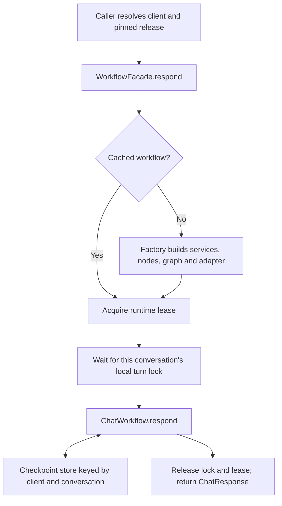

# Iteration 6: workflow construction facade and cache

Startup integration described as remaining in this historical iteration is now
implemented in [iteration 7](07_FACADE_STARTUP.md).

## Current input

> Facade the building graph state which also support caching.
> (We take the client_id and user_id and save in a dictionary the graph object that we used ?
> Or we will create a uuid runtime for a graph and then map the client_id + user_id to the uuid and uuids to the graph that we cached ?
> Or we just need to use redis ?

## Situation before this iteration

The compiler builds a graph from validated JSON and registered Python nodes.
`ChatWorkflow` is the public interface, and adapters translate requests into graph
invocations. Construction writes to `output/graph_build.jsonl`.

FastAPI builds one workflow for its configured tenant during startup and reuses it
for all requests. It injects an application-owned `AsyncPostgresSaver`. CLI startup
also builds once; its default recipe graph uses `InMemorySaver`. The offline suite
passed 307 tests before this iteration.

The missing component was a reusable owner for multiple compiled client workflows:
lookup, construction, concurrent first requests, eviction, and resource cleanup.
There is still no database resolver for immutable client releases or conversation
release pinning.

## Decision: cache the execution object separately from conversation state

```text
Runtime cache, inside each worker:
    (client_id, release_id) -> reusable ChatWorkflow + compiled graph/services

Checkpoint store, shared by rebuilt runtimes:
    thread_id = client_id + ":" + conversation_id -> saved graph state
```

Alice and Bob talking to the same chef on release v1 share one graph object.
Each invocation supplies its own thread ID, so they load different checkpoints.
Graph nodes and services must keep request-specific mutable data in invocation
state, not instance attributes. The cache cannot make a stateful service safe to
share automatically.

In this application, the legacy `user_id` denotes a browser/CLI conversation.
If accounts later support multiple conversations, keep separate user and
conversation IDs. Authentication and conversation ownership remain server concerns.

| Proposed option | Decision |
| --- | --- |
| `(client_id, user_id) -> graph` | Duplicates graphs/services for every conversation; unnecessary for the current design. |
| Conversation -> runtime UUID -> graph | Adds a second lookup without a current requirement. A build UUID remains useful in logs, but does not identify persistent state. |
| `(client_id, release_id) -> workflow` | Implemented. Separate versions can coexist; each worker constructs its own live Python objects. |
| Redis | Not needed for this runtime cache. It can store serialized configuration, cached data, or coordination records if those are needed later. It does not replace constructing live Python services and connections inside each worker. |

LangGraph persistence associates checkpoints with thread IDs; see the
[persistence documentation](https://docs.langchain.com/oss/python/langgraph/persistence).
Redis provides server-side data structures; using it for shared data rather than
live graph instances is our architectural choice; see
[Redis data types](https://redis.io/docs/latest/develop/data-types/).
The existing API already uses PostgreSQL for durable checkpoints.

## Implemented components and sequence

1. Added [`WorkflowRuntimeCache`](../../backend/workflows/runtime.py). Its factory
   receives `ClientContext` and returns an async context manager yielding a
   `ChatWorkflow`. On a miss, the cache starts one shared build task. Simultaneous
   callers for that key await the same task; cancelling one caller does not cancel
   the build for the others. Failed builds can be retried.
2. Added bounded LRU eviction (16 entries by default). Only idle, completed entries
   can be evicted. Requests hold a lease until their turn completes. When every
   entry is busy, a new key waits for capacity. Different clients can build and
   run concurrently when capacity is available.
3. Added explicit lifetime management. The factory closes resources it owns when
   evicted or when the facade closes. Shutdown stops admission, drains active
   leases, cancels orphaned builds, and closes retained resources. Factory network
   calls should have timeouts; draining is not forcibly time-bounded by the cache.
4. Added [`WorkflowFacade`](../../backend/workflows/facade.py). It validates the
   resolved client/release, acquires the runtime, and invokes `ChatWorkflow.respond`.
   `for_client(client)` returns a lightweight `ChatWorkflow` proxy compatible with
   the existing API and CLI. `warm(client)` optionally builds before a first turn.
5. Serialized simultaneous turns for the same `(client_id, conversation_id)` within
   this facade. Other conversations continue concurrently. The lock dictionary
   retains entries only while callers use or wait for them; it contains no history.
6. Added a runnable compiler/cache/checkpoint example and focused tests using
   real local LangGraph execution with deterministic nodes.



## How to use it

The executable example includes a factory and a `ChatWorkflow` adapter around the
existing JSON word-count compiler. It needs no external services:

```powershell
.\.venv\Scripts\python.exe -m backend.workflows.facade_example
```

It demonstrates two users sharing one build, eviction at a capacity of one,
Alice's checkpoint surviving eviction, and rebuilding the graph when she returns.
Builds still appear in `output/graph_build.jsonl`; a cache hit does not rebuild or
add a construction trace. Cache hit/miss messages use the application logger.

The public calling pattern, once a trusted factory and client are resolved, is:

```python
async with WorkflowFacade(factory, max_cached_workflows=16) as facade:
    await facade.warm(client)  # Optional startup construction.
    workflow = facade.for_client(client)
    response = await workflow.respond(ConversationRequest(
        client_id=client.client_id,
        release_id=client.release_id,
        conversation_id="server-resolved-conversation",
        message="Show me a recipe",
    ))
```

Create the facade once per application worker/event loop, not once per HTTP
request. In an API lifespan, expose the bound proxy as `app.state.workflow` for
the existing single-client endpoint. CLI can receive a factory returning that
proxy. The tests exercise both entry points through their existing interfaces.

Resource ownership matters: create shared checkpoint/database pools outside the
factory and close them after the facade. Put per-runtime owned clients inside
the factory's context manager and close them on exit. Creating a fresh
`InMemorySaver` per cache entry would lose that entry's history upon eviction.
The example instead creates one shared saver outside the factory. That still
loses history on process exit; production persistence remains a database concern.

## Boundaries and next change

The facade is a reusable component with an executable example; **the default
recipe API/CLI bootstrap has not been switched to it**. The existing deployment
already constructs one workflow per configured tenant. This iteration does not
make that deployment dynamically resolve multiple clients or create new routes.

The next integration step is to give shared bootstrap an owned workflow factory:
resolve a trusted client/release snapshot, build its workflow, expose per-runtime
resource cleanup, and create one facade in the application lifespan. The legacy
recipe assembly currently hides the repository database pool behind services;
its ownership must be explicit before using it in an evicting factory.

For multiple clients/releases, add server-side client lookup and persist each
conversation's pinned release before routing through this facade. Release IDs
must identify immutable workflow, prompt, model, and service configuration.
The cache checks client metadata consistency while an entry exists; it is not a
release database and cannot detect files edited beneath the same release ID.
Existing checkpoint keys deliberately remain `client:conversation`; do not switch
an existing conversation to an incompatible release without migration or a new
conversation.

Each worker has its own cache and turn locks. For more than one worker, coordinate
turns through a database-backed lock/queue or another shared mechanism with a
timeout policy. Adding Redis alone does not implement that protocol. Distributed
coordination, release pinning, authentication, and request-guard startup integration
are separate remaining work.

## Pros and tradeoffs

- One graph and its services serve many conversations for the same client version.
- A facade hides construction/cache mechanics behind the existing workflow interface.
- Concurrent first requests build once, and active workflows survive cache pressure.
- Checkpoints outlive cache eviction when persistence is owned outside the runtime.
- A bounded cache limits retained entries, but evicted resources remain alive until
  their cleanup finishes; factories must release their connections reliably.
- First use after eviction pays construction cost; workers maintain separate copies.
- The cache and factory lifecycle add complexity compared with a startup singleton.
- Configuration changes require a new release identity, and conversation pinning
  and coordination across workers still need persistent infrastructure.

## Verification

`tests/test_workflow_facade.py` has 21 passing cases covering reuse, separate
checkpoints, client/version separation, construction races and cancellation,
failure/retry, eviction and cleanup, checkpoint survival, turn serialization,
shutdown, API/CLI compatibility, and invalid factory output/cache capacity.

The runnable example completed with one build for two users and retained Alice's
checkpoint after eviction. No live model or PostgreSQL calls were needed.

Full offline verification:

```powershell
.\.venv\Scripts\python.exe -m pytest -q --ignore=tests/integration --junitxml=tmp/workflow-facade.xml
```

**328 tests passed.** PostgreSQL integration tests were excluded.
