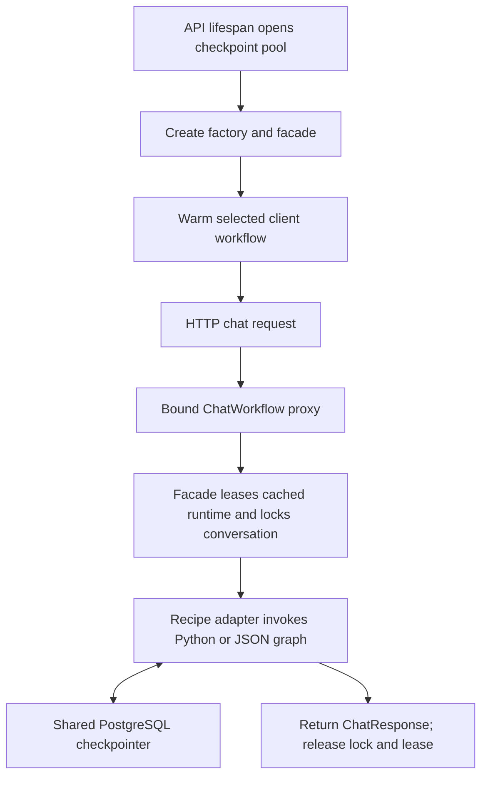

# Iteration 7: connect the facade to API and CLI startup

The guard integration identified as next below is implemented in
[iteration 8](08_GUARD_STARTUP.md). This document records the state of iteration 7.

## Current input and scope

> Add

This accepts the preceding proposed next iteration: connect the facade to the real
API and CLI, with explicit resource cleanup and shared checkpoint persistence.
Only that step is implemented here. Guard migration, JSON service bindings, and
database-backed client/releases remain later steps.

## Situation before this iteration

The compiler, graph build logger, workflow contract, and bounded runtime cache
already existed. The example showed graph reuse and checkpoints surviving cache
eviction. The offline suite passed 328 tests.

Production chat startup still called `create_chat_workflow()` directly and stored
its recipe adapter in `app.state.workflow`. CLI also built an adapter directly.
Neither entry point used `WorkflowFacade`. The recipe database pool was hidden
behind repositories, and workflow construction did not expose provider cleanup.

The problem was lifetime ownership: a cache must release connections when an
entry is evicted, and partial construction must release already-opened resources.
It must also keep checkpoint storage alive while active turns finish.

## Implemented method

1. Added `bootstrap.create_workflow_factory(checkpointer, ...)`. It resolves and
   validates the deployment configuration, copies the model/service selections,
   and returns the async context-manager factory expected by `WorkflowFacade`.
   It checks the requested client/release before constructing resources. The
   current deployment still uses one tenant and release ID `legacy`.
2. Each runtime construction owns an `AsyncExitStack`. Builders register cleanup
   immediately after creating a resource. The stack handles normal disposal and
   partial construction failure. The supplied checkpointer is not owned by this
   stack.
3. Passed that stack through recipe bootstrap, model profiles, and service/graph
   factories. Resource-aware registered builders opt in with
   `register(..., uses_resources=True)` and receive `resources=`. Existing stateless
   builders retain their constructor signatures.
4. Registered the recipe database pool's `close()` callback. OpenAI chat/embedding
   clients now receive owned sync/async HTTP transports in the managed path.
   Anthropic receives owned SDK transports; Google uses its asynchronous cleanup
   method. Disposing one runtime does not close another runtime's clients.
5. API startup creates one facade inside the PostgreSQL checkpoint pool's lifetime,
   warms the selected workflow, and exposes a bound `ChatWorkflow` proxy as
   `app.state.workflow`. `app.state.workflow_facade` exposes the facade for
   diagnostics. The existing `/chat` handler continues calling `respond()`.
6. Added `open_chat_workflow()` for CLI lifetime management. It creates one
   in-memory checkpointer outside the facade, warms the runtime, and yields a
   bound proxy. `ChatCommand` now enters this context and exits it on quit, EOF,
   interruption, or error. Embedded callers can still supply an already-built
   `ChatWorkflow`; that object remains caller-owned.
7. Tested the actual API/CLI startup paths, partial failures, eviction/rebuild,
   active-turn shutdown, and provider resource isolation.

## Request and shutdown paths



At shutdown, the API clears its exposed workflow references, the facade stops
admitting work and waits for active leases, and runtime cleanup closes owned
resources. Only after the facade exits does the API close the checkpoint pool.
Closing that pool closes connections; it does not delete persisted checkpoints.

| Resource | Owner | Lifetime |
| --- | --- | --- |
| API checkpoint connection pool/saver | API lifespan | Outlives every cached runtime and active turn |
| CLI in-memory checkpoints | `open_chat_workflow()` context | Survives runtime eviction within that CLI session; lost on process exit |
| Recipe repository database pool | Runtime resource stack | Until eviction, shutdown, or construction failure |
| Owned model/embedding transports | Runtime resource stack | Same as the runtime; profiles share one model within a runtime |
| Stateless nodes, adapters, and services | Cached workflow | Released with the runtime |

Runtime key: `(client_id, release_id)`. Checkpoint thread key:
`client_id:conversation_id`. These keys and the public HTTP request/response
formats remain the same.

## Extending managed construction

For a registered builder that opens connections, accept `resources` and register
cleanup before doing additional work that may fail. Synchronous cleanup uses
`resources.callback(resource.close)`; asynchronous cleanup uses
`resources.push_async_callback(resource.aclose)`. Register the builder with
`uses_resources=True`. Register cleanup only for resources that builder owns,
not injected shared pools or checkpointers.

The low-level `create_app()` and `create_chat_workflow()` functions still support
legacy direct construction. Managed application code should use
`create_workflow_factory()` or `open_chat_workflow()`. Direct callers passing no
resource stack do not gain automatic cleanup. Ingestion lifecycle migration is
outside this chat iteration.

The optional `create_http_app(graph_factory=...)` hook now receives `resources=`
in the managed startup path. Custom graph factories must accept this parameter
and register their owned cleanup. Resource-free implementations can ignore it.

Provider compatibility: OpenAI uses explicitly supplied HTTP transports. The
Anthropic adapter seeds the library's cached SDK client slots so eviction cannot
close library-shared transports. Google uses `aclose()`. The Anthropic and Google
dependency minimums were raised to the locally verified versions (1.7.6 and
4.4.2 respectively). Provider lifecycle tests should run on library upgrades,
particularly because the Anthropic hook uses internal cached properties.

## Pros, tradeoffs, and remaining work

- Default API and CLI now use the same cache and workflow boundary.
- Cache disposal and startup failures release owned connections explicitly.
- Checkpoints survive runtime eviction because persistence has a separate owner.
- Warming preserves startup failure visibility and avoids construction on the first turn.
- Resource-aware custom builders need to follow the ownership contract.
- Startup/assembly retains synchronous database setup; this iteration does not
  turn construction into a fully asynchronous service.
- One configured tenant still serves each deployment. No new client URL routing,
  release database, publication, or conversation pinning was added. The `legacy`
  deployment is configured at startup; this is not a hot-reload system.
- Conversation locks remain local to one worker. Multiple workers still require
  shared turn coordination.

The next planned change is to connect `GuardedWorkflow` in shared assembly and
replace the recipe's internal validation with business routing, ensuring one
admission check before graph execution. This iteration preserves existing recipe
guard behavior.

## Verification

```powershell
.\.venv\Scripts\python.exe -m pytest -q --ignore=tests/integration --junitxml=tmp/managed-workflow-startup.xml
```

**344 tests passed**, including 16 new lifecycle/provider cases. They cover actual
API reuse and independent conversation checkpoints, cleanup order, schema/graph
and partial model-construction failures, checkpoint survival after eviction,
configuration snapshotting, CLI quit/EOF/interrupt/error, and draining an active
turn before closing persistence. Provider clients were constructed and closed
offline with dummy credentials. No live model or PostgreSQL integration calls
were made.
