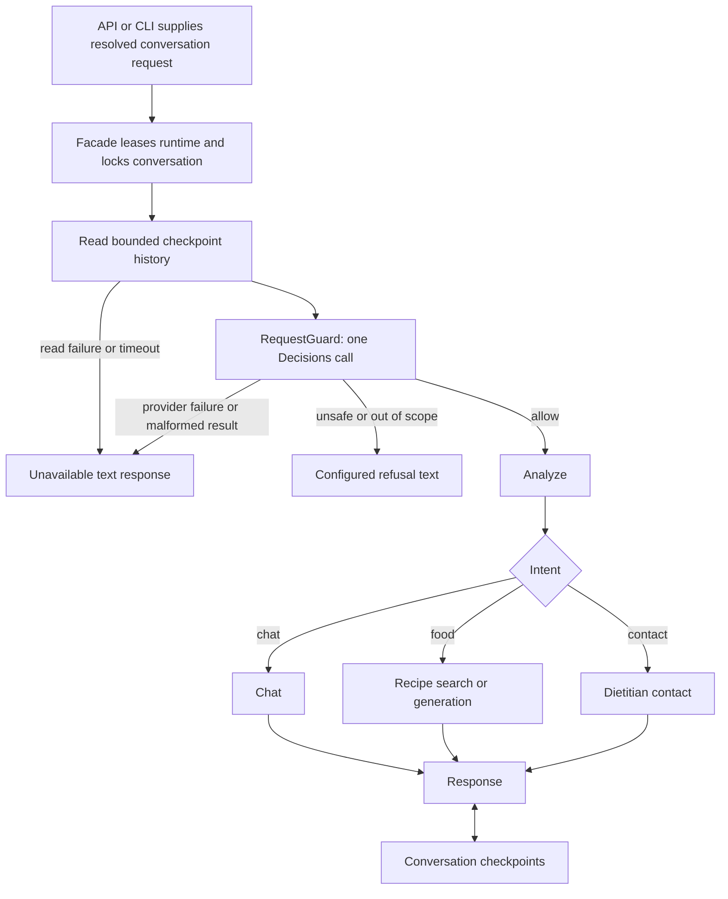

# Iteration 8: admission before graph execution

## Current input

> do it

This accepts the preceding next step: integrate the request guard into shared
construction and replace the recipe graph's internal validation with business
routing. It does not request database-backed client routing or a new compiler DSL.

## Situation before this iteration

Default API and CLI startup used the facade/cache and explicitly owned resource
cleanup. The offline suite passed 344 tests. `RequestGuard`, `GuardedWorkflow`,
and a Decisions evaluator existed, but required manual assembly.

The recipe graph still ran `analyze -> guard -> response`. Its composite guard
started validation and branch work concurrently. It stored rejection state and
continued the branch when validation failed. The API also retried the entire
workflow once on certain database failures.

The problem: the reusable admission layer was disconnected, requests could write
checkpoints before validation finished, and adding the outer wrapper without
changing the recipe graph would run two validation mechanisms.

## Implemented steps

1. Added validated `GuardConfig` in `backend/config/guard.py` and the default
   `config/guard.json`. It specifies an allowed evaluator, safety/scope policy,
   thresholds, static replies, timeout, and history bounds. There is no disable
   option. Invalid config or an unknown evaluator fails API startup before the
   checkpoint pool opens.
2. Registered `decisions` as a `GuardEvaluator` factory. The existing adapter asks
   safety and relevance questions in one request. It uses `gpt-6-luna`, as specified
   by the [official Decisions documentation](https://developers.openai.com/api/docs/guides/decisions).
   Each cached runtime owns one SDK client, reused across turns and closed on
   eviction/shutdown/construction failure. SDK retries are disabled for this call.
3. Added `CheckpointHistoryLoader`. It validates client/release identity and reads
   the latest checkpoint using `client_id:conversation_id`. It supplies only a
   bounded amount of human/assistant text; system messages, images, and other
   content types are excluded. It never invokes the graph or writes checkpoints.
4. Updated `create_workflow_factory()` to always yield
   `GuardedWorkflow(recipe_adapter, RequestGuard(...), history_loader=...)`.
   This applies to default API, CLI, and custom graph selections through managed
   bootstrap. The facade's conversation lock covers history read, admission, and
   execution, preventing overlapping local turns from checking stale history.
5. Changed both recipe graph implementations to
   `analyze -> chat / recipe / dietitian -> response`. All three branches are now
   ordinary graph nodes. Python defines the intent router; JSON selects it and
   connects its outcomes. The compiler still verifies state contracts, and the
   recipe binding verifies intent destinations.
6. Removed `guardNode()` from `RecipeChatBuilder` and `guard` from its node
   container. Bootstrap no longer constructs or invokes the legacy validator.
   Model profiles used only by the legacy validator are no longer instantiated.
7. Removed the API's automatic whole-turn database retry: replaying a workflow
   would repeat admission and might replay already-checkpointed work. A business
   database error now follows the existing HTTP 500 handling. Guard/history errors
   return the configured unavailable response and execute no graph.
8. Updated deterministic Python/JSON parity tests for the intentional new refusal
   semantics and added actual startup/entry-point tests over a mocked SDK transport.

## Current request flow



Rejected and unavailable turns return `ChatResponse` text blocks with HTTP 200;
they do not enter analysis, search, generation, presentation, or checkpoint writes.
The browser can display those replies, but neither the rejected message nor its
reply is added to persisted graph history. A later follow-up sees approved turns
only. Persisting rejected events separately would be a separate feature.

Construction still occurs at startup, including database/checkpointer setup.
The no-write guarantee concerns rejected **turn execution**, not startup schema
setup or administrative profile registration.

## Policy configuration

Selection order:

1. Explicit `guard_config=` supplied to shared bootstrap by trusted Python code.
2. The server's `GUARD_CONFIG` file path.
3. `config/dietitians/<id>/guard.json`, when present.
4. `config/guard.json`.

The complete selected config is validated and retained as the runtime's startup
snapshot. An explicit malformed/missing file fails; it does not fall back to an
allowing policy. A client override supplies a full configuration rather than a
partial merge. Prompts and policy cannot be supplied through the chat body.

The checked-in starting policy allows recipes, cooking, general nutrition,
client-contact requests, greetings, and contextual follow-ups. It sets:

| Setting | Starting value |
| --- | --- |
| Maximum unsafe probability | `0.1` (reject above this) |
| Minimum relevant probability | `0.7` (reject below this) |
| History messages considered | Latest `6` |
| History text sent to evaluator | At most `6000` characters |
| History-read timeout | `10` seconds |
| Evaluation timeout | `10` seconds, separately bounded |

These are explicit starting thresholds, not values calibrated by this iteration.
The offline tests verify routing, validation, isolation, and failure handling;
they do not measure classifier accuracy. Tune the policy and thresholds against
labeled client examples, including Hebrew follow-ups, harmless out-of-scope
requests, and attempts to override instructions. Replies are static configurable
text; use client policy files to choose their language and wording.

The loader fetches one checkpoint and bounds the text extracted for the evaluator.
This does not impose retention or size limits on stored conversation history.

`OPENAI_API_KEY` is needed by the Decisions evaluator even when the business chat
model uses another provider. Admission uses the existing Decisions adapter, so
chat model profiles and `REQUEST_VALIDATOR_MODEL_PROFILE` do not select its model.
The legacy `request_validator` service/model keys remain parseable for migration,
but have no effect on public chat admission. The old `validate.txt` template and
`GuardNode` remain only for legacy code/tests; startup does not use them.

## Boundaries and tradeoffs

- One admission decision precedes all business graph work. A rejected request
  spends no analysis/search/generation calls and adds no conversation checkpoint.
- Graph JSON configures business routing and cannot bypass the managed wrapper.
- Technical failures stop execution without labeling the user unsafe.
- Safety and scope checks remain probabilistic; model scores do not prove a
  request is secure. Authentication, ownership checks, and service permissions
  remain separate controls.
- Sequential admission adds latency before business execution, but removes the
  old speculative work and second validator. No speculative branch cancellation
  is needed for refusal.
- Startup requires a usable evaluator configuration. Provider access/availability
  is checked at request time; it was not verified against a live account here.
- Low-level `create_app()` and `create_chat_workflow()` remain internal business
  constructors. Application entry points should use managed bootstrap, which
  applies the wrapper. Generic `WorkflowFacade` itself remains policy-agnostic.
- Existing completed conversation checkpoints keep their thread keys. Old
  in-progress checkpoints that reference the removed `guard` node are not migrated;
  drain in-flight work before changing this topology. Durable release/version
  pinning and migrations remain future work.
- Deployment still resolves one client at startup. Shared turn coordination
  across workers and database-backed client/releases remain separate work.

The next assembly step is typed JSON service/prompt/model dependency bindings;
the graph topology and admission boundary now work through shared startup.

## Verification

```powershell
.\.venv\Scripts\python.exe -m pytest -q --ignore=tests/integration --junitxml=tmp/guard-startup.xml
```

**361 tests passed.** Eighteen new startup/config/history cases cover refusals,
errors, malformed probabilities, timeouts, zero graph/checkpoint activity on
rejection, approved follow-ups, SDK reuse/cleanup, one admission call despite
database failure, client policy selection, startup validation, and bounded history.
Existing Python/JSON recipe scenarios still verify modes, selected recipe images,
presentation, and conversation isolation. The removed builder-guard requirement
reduced the former builder test matrix by one case.

No live model requests or PostgreSQL integration tests were run. The default
guard path is exercised using the real SDK over an offline HTTP transport.
