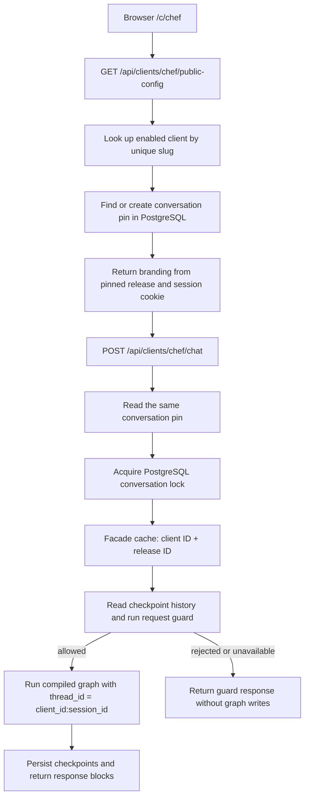

# Iteration 9 — URL clients, published releases and node bindings

## Current input

> Remaining from your original design:
> - Client lookup by URL and database-backed configuration.
> - Versioned releases and conversations pinned to their release.
> - JSON bindings that select each node's services, prompts, and models.
>
> Add this

## Situation before this change

The API loaded one tenant from files at startup. The facade already cached runtimes
by `(client_id, release_id)`, but every request used the deployment's `legacy`
release. There was no database client lookup, persistent conversation pin, or
publication operation. JSON selected graph topology; Python bootstrap selected all
of its dependencies. Changing the files and restarting could change an existing
conversation's behavior.

## Implemented flow



The first public-config or chat request pins the browser conversation. Configuration
loading sets the HTTP-only session cookie; React waits for configuration before
enabling chat. The same cookie can visit multiple clients: each client's pin and
checkpoint thread are separate. A display name is never used as an identity.

The browser sends only the message to the selected URL. It cannot submit a release
ID, prompt, service implementation, graph definition or checkpoint ID.

## Database representation

| Table | Purpose |
|---|---|
| `clients` | Stable text ID, unique URL slug, business type, enabled flag and active release |
| `client_releases` | UUID, increasing per-client version, complete JSON snapshot and SHA-256 fingerprint |
| `client_prompt_versions` | Immutable `(client_id, prompt name, version)` and template text |
| `conversations` | One `(client_id, session_id)` mapped permanently to a release and checkpoint thread |
| Existing LangGraph checkpoint tables | Conversation messages, state and execution progress |

`active_release_id` and conversation releases use composite foreign keys that
include `client_id`, preventing cross-client references. Database triggers reject
edits/deletion of published releases and prompt versions, changes to conversation
pins, and changes to a client's ID/slug/business type. A client can be disabled
with its `enabled` flag. Conversation deletion is left available for a future
explicit retention/deletion operation; it is not exposed through HTTP.

A release snapshots the profile, topology, all prompt text and version numbers,
model profiles, embedding model, guard settings and node bindings. Published
workflows do not reread tenant files or model environment overrides. Provider
credentials remain server-side environment configuration and are not stored in
the release. A changed prompt requires a new prompt version. Prompt text is
duplicated in the release to make export and reconstruction self-contained.

The complete workflow is versioned by the release. There is no separate shared
workflow catalog in this iteration. This keeps publication atomic while leaving
room to deduplicate templates later.

## How node bindings work

The checked-in [chef example](../../config/releases/chef.example.json) uses:

```json
{
  "id": "respond",
  "kind": "text_reply",
  "needs": ["message", "messages"],
  "bindings": {
    "writer": {
      "implementation": "llm",
      "model": "writer",
      "prompts": {"system": "chef_support"}
    }
  }
}
```

`writer` is a dependency slot defined by the Python node contract. Its `model`
references the release's `models.writer` profile; `system` references the complete
`prompts.chef_support` entry, including its immutable version. No constructor,
import path, executable expression or database credentials can be supplied in JSON.

Recipe bindings cover analysis, chat, recipe search/generation, contact and final
presentation. Each node gets its own prompt view. Model instances are shared within
a runtime only when their profile references are identical. Repeated node kinds
can select different bindings. Services that do not use an LLM reject model
bindings; they do not need empty columns in a wide database table.

Publication and runtime assembly validate the registered service names, model
references, required prompt slots, template placeholders, node input/output
contracts, routes and graph termination before constructing provider clients.
Factories then inject the selected objects, and the existing compiler builds the
state schema and graph. State types and service interfaces remain trusted Python.

The chef example uses a single `text_reply` node. It creates no recipe database
or embedding clients. The recipe workflow retains its analysis and three business
branches. Business type is descriptive metadata; the release's workflow determines
execution.

## Cache, persistence and concurrency

Compiled runtimes remain in the bounded in-process facade cache. PostgreSQL stores
release snapshots, pins and checkpoints. Redis is not required for this design.
Eviction closes a runtime's owned resources; rebuilding reloads the same immutable
release and accesses the same checkpoints.

Database mode adds a PostgreSQL transaction advisory lock around admission and
execution for each `client_id:session_id`. It coordinates requests across workers.
Cancellation/transaction exit releases the lock. Lock acquisition is bounded to
10 seconds; contention returns a retryable 503. Metadata, lock and checkpoint
connections use separate pools so waiting turns cannot consume every connection
needed by an executing graph.

Activating release 2 changes the default for newly created conversations. Existing
conversations stay on release 1. Activating release 1 again is a rollback for new
conversations; release-2 conversations keep their release-2 pin. There is no
automatic state migration or browser reset endpoint in this iteration.

## Files to read in order

1. [Release data models](../../backend/clients/releases.py): what a document contains.
2. [Binding contracts and runtime assembly](../../backend/workflows/release_runtime.py): validate dependencies and build nodes.
3. [Catalog schema](../../backend/clients/schema.py) and [repository](../../backend/clients/catalog.py): publication, ownership and pinning.
4. [Management CLI](../../backend/clients/manage.py): export, validate, publish and activate.
5. [Client HTTP routes](../../backend/web/client_routes.py): URL resolution and request lifecycle.
6. [React URL mapping](../../Frontend/src/clientRouting.js): matching configuration/chat URLs.

Graph construction still writes `output/graph_build.jsonl`. Database builds include
release ID, version, fingerprint and binding references; prompt content is excluded.

## Enable it in this project

No commands below were run against the application's configured database during
implementation. The existing default remains `CLIENT_CONFIG_SOURCE=file` until
the catalog is prepared. The database mode has no automatic fallback to file
configuration.

For the current recipe client, stop/drain the old server before the migration so
there are no checkpoints waiting at removed or renamed graph nodes. Back up the
database and retain the original file configuration.

```powershell
# Offline: capture the current resolved profile, prompts, models and service choices.
.\.venv\Scripts\python.exe -m backend.clients.manage export-legacy --client-id clinic_001 --output config/releases/clinic_001.json
.\.venv\Scripts\python.exe -m backend.clients.manage validate config/releases/clinic_001.json

# Administrative database operations, using the configured DB connection.
.\.venv\Scripts\python.exe -m backend.clients.manage migrate
.\.venv\Scripts\python.exe -m backend.clients.manage create-client --client-id clinic_001 --slug alona --business-type dietitian
.\.venv\Scripts\python.exe -m backend.clients.manage publish config/releases/clinic_001.json --activate --adopt-legacy-checkpoints

# Enable URL routing, then launch the API.
$env:CLIENT_CONFIG_SOURCE='database'
.\.venv\Scripts\python.exe run_api.py
```

Open `/c/alona`. Preserve `CLIENT_CONFIG_SOURCE=database` in deployment environment
configuration for subsequent starts. The existing recipe schema must already be
prepared; a new recipe database can be prepared using the existing
`python -m backend.persistence.migrate` command. The catalog migration itself is
additive and does not rename recipe ownership columns.

`--adopt-legacy-checkpoints` is allowed only for the first release. It imports
existing checkpoint thread IDs with the exact client prefix into the conversation
table, pointing them at that initial release. Without adoption, old browser cookies
would be treated as unpinned conversations. Keep the exported initial workflow
compatible with those completed checkpoints. This does not resume incompatible
in-progress graphs.

Add the chef demo independently:

```powershell
.\.venv\Scripts\python.exe -m backend.clients.manage validate config/releases/chef.example.json
.\.venv\Scripts\python.exe -m backend.clients.manage create-client --client-id chef_demo --slug demo-chef --business-type chef
.\.venv\Scripts\python.exe -m backend.clients.manage publish config/releases/chef.example.json --activate
```

Open `/c/demo-chef` on the same server. Confirm that the example's model IDs are
available to your provider account before live use; schema validation cannot
determine that. Review and evaluate each client's guard policy and thresholds.

For the next release, edit a copy of the JSON, increment any changed prompt's
version, validate and publish. Publish without `--activate` to stage a release.
Use these commands to inspect, activate, roll back or reconstruct a document:

```powershell
.\.venv\Scripts\python.exe -m backend.clients.manage list --client-id clinic_001
.\.venv\Scripts\python.exe -m backend.clients.manage activate --client-id clinic_001 --release-id RELEASE_UUID
.\.venv\Scripts\python.exe -m backend.clients.manage export --client-id clinic_001 --release-id RELEASE_UUID --output config/releases/exported.json
```

Management commands are trusted operator actions. They are not exposed as public
API endpoints. The original `main.py chat` and ingestion commands remain file-based
tools; database conversation routing is the HTTP path described here.

## Pros and cons

| Benefit | Cost or constraint |
|---|---|
| Multiple client URLs share one API and deployment | The catalog and checkpoint database become required infrastructure |
| Conversation behavior survives release activation and restarts | Old releases and their compatible Python implementations must remain available |
| Prompt/model/service changes can be published without changing graph code | New capabilities still require reviewed Python implementations and deployment |
| Complete snapshots can be exported and rebuilt | Prompt/configuration content is duplicated; database backups remain essential |
| Database constraints and locks protect ownership and turn ordering | Each active/queued turn uses a lock connection; pool capacity needs operational sizing |
| Existing recipe rows, image files and checkpoint keys are retained | Recipe internals still use historical `dietitian_id` names and folders |

JSON release versioning does not freeze Python package versions or upstream model
behavior. Avoid changing an existing registered implementation incompatibly; add a
new versioned implementation name or migrate deliberately. The compiler still
supports its existing acyclic, single-active-branch language. This work does not
add arbitrary concurrent branches or executable user-supplied nodes.

Recipe vectors still have 1536 dimensions. Changing the embedding model requires
compatible stored vectors and, normally, reindexing; publishing a release does not
automatically regenerate embeddings.

## Verification and practical limits

Tests cover rejected bindings before resource construction; independent service,
prompt and model injection; cache eviction with checkpoint retention; PostgreSQL
foreign keys and immutability; concurrent pin creation; activation/rollback;
cross-worker turn locks; legacy checkpoint adoption; client-specific HTTP routes,
images and branding; restart persistence; and refusal without graph writes.

The PostgreSQL suite creates a disposable loopback cluster under the test temporary
directory. It never uses the application's database connection. Provider calls in
tests use local doubles. Existing process-local rate limiting remains unchanged;
shared rate limiting and a client administration UI are separate work. Public
client URLs identify a chatbot; they are not an authentication system.

Verification on 2026-10-26: **377 backend unit/regression tests, 12 isolated
PostgreSQL integration tests, and 33 frontend tests passed**. Frontend lint and
production build passed. The database tests also exercise normal database-mode
startup with three owned pools and no tenant-file loading. Reports are in
`tmp/client-releases-unit.xml` and `tmp/client-releases-postgres.xml` (ignored test
artifacts). Windows PostgreSQL tests require a selector event loop and permission
to start the temporary local server; both CLI and API launchers select the
compatible loop.

The deployment step is to prepare and import the catalog, switch the environment
mode, and exercise real provider calls with representative client conversations.
