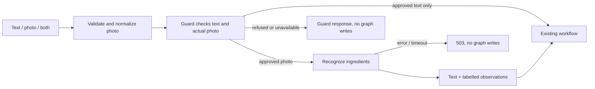

# Iteration 10 — photo messages and ingredient recognition

The one-photo format below records this iteration. [Iteration 11](11_MULTIPLE_PHOTOS.md)
extends it to an `images` collection of up to ten photos, retaining compatibility
with the original `image` field.

## Current input

> Add to user a field for image sending, and add in the frontend the option to upload a photo.
> Then a user can send a text or an image or both, for example he says that he wants a salty recipe and sends a photo of his ingredients.
> Our system will detect that the user sent us a photo and use a model photo recognition to detect what they are, and continue the regular flow.

## Situation before this change

Chat requests required nonempty text. The frontend had a textarea and send button.
The guard received only text, and every graph expected a textual message. Client
release snapshots already controlled workflow topology, service bindings, prompts
and models. There is no registered end-user profile table: the browser session
identifies a conversation.

The image field therefore belongs to **each chat message**, rather than becoming a
permanent avatar or a mutable field on a cached graph object.

## Implemented request

Both `/chat` and `/api/clients/{slug}/chat` accept the same JSON:

```json
{
  "message": "I want a salty recipe",
  "image": {
    "mime_type": "image/jpeg",
    "data": "BASE64_IMAGE_BYTES"
  }
}
```

Text-only requests omit `image`. Photo-only requests can omit `message` or send an
empty string. Requests containing neither are rejected. One photo is supported per
turn. Browser filenames and preview URLs are not sent to the server.

## Processing steps

1. React reads the selected file, checks its type/size, and displays a preview with
   a remove button. The send button accepts text, a photo, or both. Failed sends
   retain the draft for retry. Selecting another client cancels outstanding work.
2. An ASGI middleware bounds the request body before JSON parsing, including
   chunked requests. Pydantic validates the actual image format, size, dimensions
   and single-frame requirement. Validation errors do not echo uploaded bytes.
3. After rate limiting and conversation locking, a worker thread fully decodes the
   photo, corrects its orientation, reduces it to at most 1536 pixels per side,
   strips metadata including EXIF/GPS, and produces JPEG bytes in memory.
4. The existing guard evaluates the **actual normalized image and accompanying
   text together**. Rejected or unavailable admission does not run recognition or
   the checkpoint-writing graph.
5. For an approved image, the configured vision service returns structured
   `ingredients`, `uncertain_items`, and `description`. The default model is
   `gpt-5.4-mini`. Its client is created lazily on the first approved photo and
   closed with the cached runtime. Text-only messages incur no vision call.
6. The input processor keeps the user's text and appends clearly labelled image
   observations. A photo-only request receives a cooking-request introduction.
   Uncertain items remain explicitly separate, with instructions to clarify rather
   than guess when the photo does not establish the ingredients.
7. The existing analyzer and recipe/chat flow receive that combined textual
   message. For example, `salty` remains in the text while `tomato` and `cucumber`
   come from the image. Existing recipe search, generation, response formatting,
   client isolation and checkpoint keys remain in use.



The raw upload is not stored in the database, checkpoint, or graph cache. The
browser keeps its preview during the current page session. Checkpoints retain the
combined text and observations so later requests can refer to the ingredients.
The normalized photo is sent to the configured guard and vision providers; this
change does not define those providers' retention policies.

## Configuration and published releases

File-based deployments load
[`config/image_recognition.json`](../../config/image_recognition.json). It selects
the registered recognizer, model profile, extraction prompt and timeout.
`IMAGE_RECOGNITION_CONFIG` can select another trusted configuration file. The
default uses the existing OpenAI credentials. Choose an image-capable model that
supports structured output if changing providers.

For database mode, a release may include an `image_recognition` object with exactly
that configuration shape. It is part of the immutable release snapshot. New
`export-legacy` documents include it, and the chef example now demonstrates it.
The public configuration exposes only upload capability/limits, never the model
configuration or recognition prompt.

**Existing releases are preserved.** An absent `image_recognition` field means
text-only. Serialization omits that absent capability, so old stored fingerprints
still verify. Existing conversation pins do not silently acquire a new model or
prompt. Their frontend hides the upload control, and forged photo requests receive
a 422 response.

To enable photos for a published client:

1. Export its release using `backend.clients.manage export`.
2. Add the `image_recognition` object from `config/image_recognition.json`.
3. Validate and publish/activate the new document using the existing management CLI.
4. Start a new conversation/session on that release; existing pinned conversations
   keep their previous capabilities. A fresh browser/private session can be used
   for verification while there is no new-conversation UI.

No schema migration is needed for this capability. No configured application
database was modified during implementation. File mode enables photos after the
backend is restarted and the updated frontend is served.

## Limits and tradeoffs

Uploads must be JPEG, PNG or WebP, at most **5 MB and 20 megapixels**, and contain a
single frame. SVG, animated images, remote URLs and arbitrary files are rejected.
There is a 16,000-character public text limit. JSON/base64 preserves the existing
endpoint contract but adds approximately one-third to upload size. HEIC is not
supported; convert it to JPEG before uploading.

The shared preprocessing step works with both existing Python/JSON recipe graphs
and generic published text workflows. Graph schemas do not need image-byte
channels. The cost is one additional vision call for an admitted photo and image
input to the guard. Recognition adds latency and can be wrong; the extraction
prompt separates uncertain observations and prohibits claims about hidden
ingredients, allergens, freshness or edibility. This is ingredient assistance, not
a reliable food-safety inspection.

The application stores the textual observation, not an image archive. Re-examining
the actual photo on a later turn requires uploading it again. An object-storage
attachment archive would be a separate feature with its own retention/access rules.

## Verification

Verified on 2026-10-26: **403 backend unit/regression tests, 13 isolated PostgreSQL
integration tests, and 38 frontend tests passed**. Frontend lint and the production
build also passed. Reports are `tmp/photo-chat-unit.xml` and
`tmp/photo-chat-postgres.xml` (ignored local artifacts).

Tests exercise text/photo/combined validation; malformed files, type spoofing,
oversized/chunked uploads and truncated JPEGs; metadata removal and orientation;
actual OpenAI SDK request serialization against an offline HTTP transport; image
admission before recognition; recipe flow with preserved text preferences; timeout
and provider failure without checkpoint writes; follow-up history; lazy resource
cleanup; old release fingerprints; PostgreSQL release pinning and photo capability;
and frontend file selection, preview rendering and transport payloads.

No live vision or Decisions calls were made. Model quality on real ingredient
photos still needs evaluation with your provider account. The provider request
formats were checked against the installed SDK and official documentation:
[Decisions image input](https://developers.openai.com/api/docs/guides/decisions)
and [GPT-5.4 Mini modalities and structured output](https://developers.openai.com/api/docs/models/gpt-5.4-mini).

The main implementation files are
[`chat_input.py`](../../backend/models/chat_input.py) for the message/image contract,
[`image_recognizer.py`](../../backend/services/chat/image_recognizer.py) for the vision service,
[`image_input.py`](../../backend/workflows/image_input.py) for the conversion into graph input,
and [`ChatInput.jsx`](../../Frontend/src/components/ChatInput.jsx) for the upload controls.
